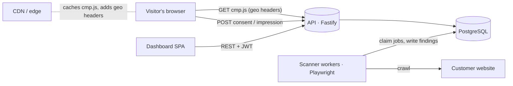

# ConsentFlow: requirements specification

Version 0.1 (MVP) · Status of each requirement reflects this repository.

## 1. Purpose and scope

ConsentFlow is a cookie consent management platform (CMP) in the style of Cookiebot and the cookie-consent module of OneTrust. It lets a website owner:

1. find every cookie and tracker on their site (scanner),
2. show a consent banner that follows the visitor's local law (banner + geo rules),
3. stop trackers from running until the visitor allows them (script blocking),
4. pass consent signals to Google and other tag platforms (Google Consent Mode v2),
5. keep proof of every consent decision (consent log), and
6. publish an up-to-date cookie declaration.

Out of scope for the MVP, planned for later phases: IAB TCF v2.2 and GPP strings, Google CMP certification, mobile SDKs, A/B testing, data subject request (DSAR) workflows, vendor risk management, and other OneTrust-style privacy modules. See section 8.

### 1.1 Users

| Persona | Goal |
|---|---|
| **Site owner / marketer** (admin, editor) | Make the site compliant without engineering help: scan, categorize, design the banner, publish. |
| **Privacy or legal reviewer** (viewer) | Check what the site sets, read the consent log, export proof. |
| **Developer** | Install one script tag, mark custom tags, read consent in code. |
| **Website visitor** | Understand what is collected, choose, and change the choice later. |

### 1.2 Definitions

- **Domain**: one website (hostname, plus optional aliases) with its own configuration.
- **Category**: necessary, preferences, statistics, marketing. Anything not yet categorized is *unclassified* and treated as marketing.
- **Consent model**: *opt-in* (nothing optional runs until the visitor agrees, e.g. GDPR), *opt-out* (allowed until the visitor objects, e.g. CCPA), *notice* (inform only).
- **Consent record**: one stored decision with a pseudonymous consent ID.

## 2. Functional requirements

Priority: **M** = must (MVP), **S** = should, **C** = could. Status: ✅ implemented, ⏳ planned.

### 2.1 Accounts, workspaces and roles

| ID | Requirement | Pri | Status |
|---|---|---|---|
| ACC-1 | A person can sign up with name, email and password; this creates a workspace (organization) with them as owner. | M | ✅ |
| ACC-2 | Sign-in with email and password returns a session token valid for 7 days. Passwords are stored with scrypt and a per-user salt. | M | ✅ |
| ACC-3 | Roles: owner, admin, editor, viewer. Viewers read only; editors change banners, cookies, rules and run scans; admins also manage domains and the team; owners also manage owners. | M | ✅ |
| ACC-4 | Admins invite people by email and role. The invitation link is valid for 7 days and works for new and existing accounts. | M | ✅ |
| ACC-5 | A workspace always keeps at least one owner. | M | ✅ |
| ACC-6 | A user can belong to several workspaces and switch between them. | S | ✅ |
| ACC-7 | Every configuration change is written to an audit log (who, what, when, which domain). Admins can read it. | M | ✅ |
| ACC-8 | Single sign-on (SAML/OIDC) and SCIM provisioning. | C | ⏳ |
| ACC-9 | Rate limiting on sign-up and sign-in. | M | ✅ |

### 2.2 Domains

| ID | Requirement | Pri | Status |
|---|---|---|---|
| DOM-1 | Admins add a domain by entering a URL or hostname; it is normalized (lower case, no scheme or path). Duplicates in a workspace are rejected. | M | ✅ |
| DOM-2 | A new domain gets a random public key, a published default banner, the default geo rules (2.5) and the ConsentFlow consent cookie declared as necessary. | M | ✅ |
| DOM-3 | Settings: privacy policy URL, consent lifetime (1–730 days, default 365), scan frequency (weekly, monthly, off), pages per scan, extra hostnames, Google Consent Mode on/off, automatic blocking on/off. | M | ✅ |
| DOM-4 | Admins can rotate the public key (old script URL stops working) and delete a domain after typing its name. | M | ✅ |
| DOM-5 | The overview shows install instructions, a compliance score with individual checks, inventory counts and consent statistics. | M | ✅ |

### 2.3 Scanner

| ID | Requirement | Pri | Status |
|---|---|---|---|
| SCN-1 | Editors start a scan on demand. Only one scan per domain can be queued or running. | M | ✅ |
| SCN-2 | Scheduled scans are queued automatically according to the domain's frequency. | M | ✅ |
| SCN-3 | The scanner loads pages in a real headless browser as a first-time visitor who has not interacted with any banner. It follows same-site links and the sitemap, up to the page limit, skipping files and tracking parameters. | M | ✅ |
| SCN-4 | It records cookies (name, domain, expiry, flags), localStorage and sessionStorage keys, third-party scripts, third-party iframes and tracking pixels, with the first page each was seen on. | M | ✅ |
| SCN-5 | Each finding is categorized from a shared library of known cookies (exact names and patterns, optionally bound to a provider domain) and known tracker URLs. Unknown items are *unclassified*. | M | ✅ |
| SCN-6 | Findings update the domain inventory without overwriting anything a person edited. New items are counted per scan. | M | ✅ |
| SCN-7 | Statistics, marketing or unclassified cookies set before consent are flagged on the scan and in the compliance checks. | M | ✅ |
| SCN-8 | Several scanner workers can share the queue safely; a scan whose worker stops responding is marked failed after 30 minutes. | M | ✅ |
| SCN-9 | Scans from several regions (EU, US) and alerts by email when new unclassified cookies appear. | S | ⏳ |

### 2.4 Cookie and script inventory

| ID | Requirement | Pri | Status |
|---|---|---|---|
| INV-1 | List every declared cookie and storage item with type, provider, category, vendor, purpose and expiry; filter by category. | M | ✅ |
| INV-2 | Editors change the category inline, edit details, add items by hand (pre-filled from the library when known) and remove items. Edited items are marked so scans never overwrite them. | M | ✅ |
| INV-3 | List third-party script and iframe patterns with their category; editors change categories and add rules. | M | ✅ |
| INV-4 | Changes reach the live banner within 30 seconds (configuration cache lifetime). | M | ✅ |

### 2.5 Geo rules

| ID | Requirement | Pri | Status |
|---|---|---|---|
| GEO-1 | Each domain has ordered rules: name, regulation (GDPR, CCPA, LGPD, none), consent model, regions (ISO country codes, subdivision codes like `US-CA`, or `*`), honor GPC, priority, enabled. | M | ✅ |
| GEO-2 | Defaults: GDPR opt-in for EU 27, EEA, UK and Switzerland; LGPD opt-in for Brazil; opt-out for California and the other US states with comprehensive privacy laws; notice-only for the rest of the world. | M | ✅ |
| GEO-3 | Matching: subdivision beats country beats `*`; higher priority wins among equals; when nothing matches, the strict opt-in model applies. | M | ✅ |
| GEO-4 | The visitor's location comes from CDN headers (Cloudflare, CloudFront, Vercel, App Engine, or a generic `X-Country-Code`). A query-string override exists for testing and can be disabled. | M | ✅ |
| GEO-5 | The dashboard can test a location against the edited (unsaved) rules. | S | ✅ |

### 2.6 Banner and preference center

| ID | Requirement | Pri | Status |
|---|---|---|---|
| BAN-1 | Layouts: box (bottom left/right/center), full-width bar (top/bottom), centered popup with backdrop. | M | ✅ |
| BAN-2 | Theme: background, text, primary and secondary button colors, corner radius, font family, custom CSS. | M | ✅ |
| BAN-3 | Opt-in regions show Accept all, Reject all (same styling as Accept all) and Customize on the first layer. Hiding Reject all is possible but fails a compliance check. | M | ✅ |
| BAN-4 | Opt-out regions show a "Do Not Sell or Share My Personal Information" option and an acknowledgment button. Notice regions show an information banner. | M | ✅ |
| BAN-5 | The preference center lists the four categories with descriptions, a locked toggle for necessary, toggles for the others, and the cookies in each category. Buttons: Reject all, Save my choices, Accept all. | M | ✅ |
| BAN-6 | A floating button (optional) and a JavaScript call let visitors reopen the preferences at any time; withdrawing is as easy as giving consent. | M | ✅ |
| BAN-7 | Built-in translations for English, German, French and Spanish. Admins choose languages and a default, and can override any text per language. The banner picks the language from the script tag, the page `lang`, then the browser. | M | ✅ |
| BAN-8 | The banner renders in a Shadow DOM so site CSS cannot break it; it is keyboard accessible, uses dialog roles and labels, moves focus into modal dialogs, and closes the preference center with Escape. | M | ✅ |
| BAN-9 | Banner changes are saved as a draft. Publishing creates a new version; visitors whose stored consent has an older version are asked again. Version history is kept. | M | ✅ |
| BAN-10 | The dashboard shows a live preview of the draft for each region and language, using the real banner code. | M | ✅ |
| BAN-11 | A/B testing of banner variants. | C | ⏳ |

### 2.7 Embed script and blocking

| ID | Requirement | Pri | Status |
|---|---|---|---|
| EMB-1 | Installation is one `<script>` tag placed first in `<head>`. The configuration (resolved for the visitor's region) is inlined in the script response so everything runs synchronously before other tags. | M | ✅ |
| EMB-2 | Automatic blocking: scripts and iframes whose URL matches a known tracker pattern or a domain rule are neutralized as they are added, both for tags in the HTML and tags created by other scripts, and re-inserted when the category is allowed. Unclassified scripts are not blocked automatically. | M | ✅ |
| EMB-3 | Manual blocking: `<script type="text/plain" data-category="…">` and `<iframe data-cf-src="…" data-category="…">` run only after consent. | M | ✅ |
| EMB-4 | Blocked iframes are replaced with a placeholder that explains why and offers to allow that category. | M | ✅ |
| EMB-5 | Consent is stored in a first-party cookie (`cf_consent`) with consent ID, banner version, choices, timestamp, regulation and action, for the configured lifetime. | M | ✅ |
| EMB-6 | When a category is withdrawn, the script deletes that category's first-party cookies and reloads the page so already running scripts stop. | M | ✅ |
| EMB-7 | Global Privacy Control is honored when the matching rule says so: in opt-out regions marketing (sale/share) is turned off automatically and recorded as `gpc_opt_out`. | M | ✅ |
| EMB-8 | Google Consent Mode v2: defaults are pushed before any Google tag (`ad_storage`, `ad_user_data`, `ad_personalization`, `analytics_storage`, `functionality_storage`, `personalization_storage`, `security_storage`, `wait_for_update`), followed by updates on every change, plus `ads_data_redaction`. | M | ✅ |
| EMB-9 | Every change pushes a `consentflow_update` event to the data layer and fires a `consentflow:change` DOM event. | M | ✅ |
| EMB-10 | JavaScript API on `window.ConsentFlow`: `getConsent()`, `hasConsent(category)`, `show()`, `showPreferences()`, `acceptAll()`, `rejectAll()`, `setConsent()`, `withdraw()`, `on('change', fn)`, `consentId`. | M | ✅ |
| EMB-11 | The script is under 35 KB minified (about 11 KB gzipped) and never throws into the host page when the API is unreachable. | M | ✅ |
| EMB-12 | IAB TCF v2.2 (`__tcfapi`, TC string), IAB GPP and US Privacy strings. | S | ⏳ |

### 2.8 Consent records

| ID | Requirement | Pri | Status |
|---|---|---|---|
| REC-1 | Every decision is stored: domain, consent ID, action (accept all, reject all, custom, withdraw, GPC opt-out, notice acknowledged), the three optional choices, banner version, regulation, country and region, truncated IP (IPv4 /24, IPv6 /48), user agent, page URL, GPC flag, time. | M | ✅ |
| REC-2 | The consent endpoint accepts posts only from the domain's hostnames (and their subdomains) and is rate limited. | M | ✅ |
| REC-3 | Banner impressions are counted per day and country, so consent and interaction rates can be computed. | M | ✅ |
| REC-4 | The dashboard lists records with filters (consent ID or URL, decision, country, date range) and pagination, and exports them to CSV with formula-injection protection. | M | ✅ |
| REC-5 | Visitors see their consent ID in the cookie declaration; a public endpoint returns the history for a consent ID (data subject access). | S | ✅ |
| REC-6 | Statistics: daily decisions vs impressions, accept/reject/custom rates, opt-in rate per category, top countries, for 7, 30 or 90 days. | M | ✅ |

### 2.9 Cookie declaration and integrations

| ID | Requirement | Pri | Status |
|---|---|---|---|
| DEC-1 | `

` on any page renders the current cookie declaration per category, the visitor's current choices and consent ID, and a button to change them. | M | ✅ |
| INT-1 | WordPress plugin: settings page for API URL and domain key, prints the script first in `<head>`, shortcodes for the declaration and a settings link. | M | ✅ |
| INT-2 | Google Tag Manager community template. | S | ⏳ |
| INT-3 | Shopify app, Wix and Webflow guides. | C | ⏳ |

### 2.10 Compliance checks

The overview runs these checks and shows a score (share passed). They help users find problems; they are not legal advice.

1. The banner script is installed (activity in the last 7 days).
2. The site was scanned in the last 30 days.
3. Every cookie has a category.
4. No statistics, marketing or unclassified cookies were set before consent in the last scan.
5. Reject all is shown on the first layer wherever an opt-in rule is active.
6. A privacy policy is linked.
7. A banner is published.

## 3. Interfaces

### 3.1 Public (called by websites)

| Method & path | Purpose |
|---|---|
| `GET /v1/cmp/:key/cmp.js` | Embed script with the visitor's configuration inlined. |
| `GET /v1/cmp/:key/config.json` | The same configuration as JSON. |
| `GET /v1/cmp-core.js` | Banner code without configuration (dashboard preview). |
| `POST /v1/consent` | Record a decision (`text/plain` JSON body, no CORS preflight). |
| `POST /v1/cmp/:key/impression` | Count a banner impression. |
| `GET /v1/cmp/:key/consents/:consentId` | A visitor's own consent history. |
| `GET /health` | Liveness and database check. |

### 3.2 Dashboard API

All under `/api`, bearer token authentication, JSON. Groups: `auth` (register, login, accept invite, me), `orgs` (rename, members, invitations, audit), `domains` (CRUD, overview, rotate key), `scans`, `cookies` and `scripts`, `banner` (draft, publish, versions, preview config), `geo-rules`, `consents` (list, CSV export, stats), `library/cookies`. See `apps/api/src/routes`.

## 4. Non-functional requirements

| ID | Requirement | Status |
|---|---|---|
| NFR-1 **Performance** | `cmp.js` is served from an in-memory cache of the domain configuration (30 s) with geo resolution per request; responses are cacheable by the browser for 5 minutes. Target p95 under 50 ms at the origin; put a CDN in front in production. | ✅ |
| NFR-2 **Host-site safety** | The banner must never break the host page: isolated styles (Shadow DOM), no global CSS, network failures swallowed, double-loading detected. | ✅ |
| NFR-3 **Security** | Passwords hashed with scrypt; JWT secret required in production; role checks on every dashboard route (non-members get 404, not 403); request validation with Zod; SQL parameterized; CSV injection neutralized; consent posts checked against the domain's hostnames; rate limits on public and auth endpoints. | ✅ |
| NFR-4 **Privacy by design** | No raw IP addresses stored; consent IDs are random UUIDs; the visitor's consent cookie is first party; no third-party calls from the banner other than to the ConsentFlow API. | ✅ |
| NFR-5 **Scalability** | Stateless API (scale horizontally); scanner workers scale independently using `FOR UPDATE SKIP LOCKED`; consent records indexed by domain and time with a BRIN index on time. At high volume, partition `consent_records` by month and move it to a column store (see DB schema doc). | ✅ / ⏳ |
| NFR-6 **Accessibility** | Banner and dashboard meet WCAG 2.1 AA: keyboard operable, visible focus, labels, sufficient contrast with default colors, reduced-motion respected. | ✅ (manual audit pending) |
| NFR-7 **Browser support** | Embed script targets ES2017 (all evergreen browsers, Safari 12+). | ✅ |
| NFR-8 **Observability** | Structured JSON logs (pino via Fastify); health endpoint; scanner logs each job. | ✅ |
| NFR-9 **Data retention** | Consent records kept for the life of the domain by default (needed as proof); configurable retention and deletion jobs are planned. | ⏳ |
| NFR-10 **Testing** | Unit tests for shared logic and the banner (jsdom), integration tests for the API against PostgreSQL, CI on every push. | ✅ |

## 5. Architecture

- `packages/shared`: types, translations, geo-rule resolution, categorization, Consent Mode mapping. Used by every app.
- `packages/banner`: the embed script (vanilla TypeScript, bundled with esbuild).
- `apps/api`: Fastify REST API, migrations, seed data, public embed endpoints.
- `apps/scanner`: queue worker that crawls sites with Playwright.
- `apps/dashboard`: React single-page app.

## 6. Acceptance criteria (MVP)

1. A new user can sign up, add a domain, copy the script tag and see a working banner on their site within five minutes.
2. On a page where a tracker script categorized as statistics or marketing (for example the Meta Pixel) is installed after the ConsentFlow script, the tracker's cookies do not exist before the visitor accepts (automatic blocking) or after Reject all, and they appear after Accept all.
3. A visitor from Germany sees an opt-in banner with Reject all; a visitor from California sees the Do Not Sell option; a visitor from California with GPC sees no banner and a `gpc_opt_out` record is stored.
4. Every decision appears in the consent log within seconds and can be exported to CSV.
5. A scan of a site lists its cookies with categories from the library, and flags tracking cookies set before consent.
6. Publishing a banner change re-prompts returning visitors.
7. A viewer cannot change anything; a user from another workspace cannot see the domain.

All seven are covered by automated tests or the end-to-end checks described in the README.

## 7. Assumptions and constraints

- Geo-IP is provided by the CDN or load balancer in front of the API. Without it, visitors fall under the `*` rule (or `DEFAULT_COUNTRY`).
- Email delivery is not part of the MVP; invitation links are shown to the admin to send.
- Legal texts and default categorizations are reasonable defaults, not legal advice. A privacy lawyer should review templates before commercial launch.

## 8. Roadmap after the MVP

1. IAB TCF v2.2 CMP registration and `__tcfapi`; IAB GPP for US states.
2. Google-certified CMP status (required by Google for EEA/UK ad serving).
3. Google Tag Manager template, Shopify app, mobile SDKs (iOS, Android, React Native, Flutter).
4. Multi-region scanning, scheduled email reports, new-cookie alerts.
5. A/B testing of banners, consent-rate optimization reports.
6. Agency accounts (manage many client workspaces), billing by domain and page count.
7. Retention policies for consent records; monthly partitioning.
8. OneTrust-style modules: DSAR intake and workflow, preference center for marketing subscriptions, records of processing, vendor risk assessments.
